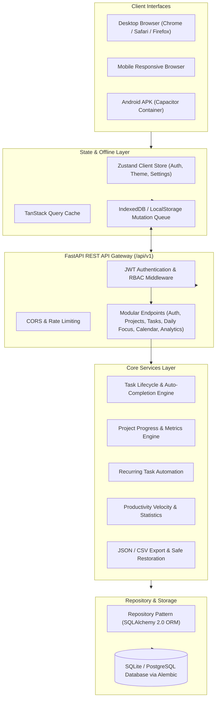

# MileStone Architecture & System Design Documentation

## 1. Architectural Philosophy
MileStone is built with a high-performance **modular service-repository pattern** on the backend and an **offline-first reactive state container** on the frontend, packaged natively for mobile via Capacitor.

---

## 2. Core Modules Breakdown

### 2.1 Backend Modules (`backend/app`)
- **`core/`**: Configuration via Pydantic BaseSettings, SQLite/PostgreSQL engine initialization, session generator, password hashing with bcrypt, and JWT token issuing.
- **`models/`**: Normalized SQLAlchemy 2.0 models with UUID primary keys, foreign keys, timestamps, indexes, and cascading delete logic.
- **`schemas/`**: Pydantic request and response models enforcing rigorous validation.
- **`repositories/`**: Clean separation of database access queries, filtering, and sorting logic from route handlers.
- **`services/`**: Encapsulates business logic:
  - Automatically moving tasks to `COMPLETED` and setting timestamps.
  - Dynamically recalculating project progress percentage: `(completed_tasks / total_tasks) * 100`.
  - Spawning subsequent occurrences for recurring tasks upon completion.
  - Generating audit trail logs for all operations.
  - Computing dashboard analytics and weekly velocity trends.
- **`api/v1/`**: Clean modular route controllers grouped by entity.

### 2.2 Frontend Modules (`frontend/src`)
- **`components/`**: Reusable atomic UI components (`TaskCard`, `TaskDetailModal`, `CreateTaskModal`, `CreateProjectModal`, `SyncStatusIndicator`, `ConfirmDialog`).
- **`layouts/`**: `Sidebar`, `Header`, `MobileNav`, and `AppLayout` providing responsive navigation across desktop and mobile.
- **`pages/`**: View controllers:
  - `DashboardPage`: High-level productivity analytics, weekly trend chart, project progress bars.
  - `TasksPage`: The 3-view task architecture (**Pending Tasks**, **Completed Tasks**, **All Tasks**) with multi-filters.
  - `DailyFocusPage` ("My Day"): Curated daily focus list with daily progress tracker and non-destructive reset.
  - `ProjectsPage` & `ProjectDetailPage`: Dedicated project dashboards with isolated milestones.
  - `CalendarPage`: Monthly interactive calendar grid with click-to-schedule.
  - `OverduePage`: Dedicated detection of past-due tasks with instant reschedule workflows.
  - `AnalyticsPage`: Detailed Recharts visualizations.
  - `ArchivePage`: Safe storage and one-click restoration of retired projects and tasks.
  - `SettingsPage`: Theme selector, live API endpoint configuration with connection test, and JSON/CSV backup utilities.
- **`store/`**: Lightweight Zustand stores for Authentication, Theme, Server URL configuration, and Offline Queue.
- **`services/`**: API client with automatic token injection, offline error interception, and background sync worker.

---

## 3. Offline & Multi-Device Synchronization
1. **Network Detection**: Tracks online/offline status using window events and Capacitor network listeners.
2. **Optimistic Local Execution**: When a user marks a task completed or modifies data while offline, UI updates immediately.
3. **Queue Replay**: Mutative HTTP requests (`POST`, `PUT`, `DELETE`) that fail due to network loss are serialized in the local storage mutation queue.
4. **Conflict Resolution**: When connectivity returns, the background sync worker drains the queue in chronological order. Missing records (404) are safely purged without failing subsequent transactions.

---

## 4. Security Architecture
- Passwords hashed using bcrypt.
- Stateless, cryptographically signed JWT tokens with expiry.
- Strict user data isolation: all repository queries filter by `user_id == current_user.id`.
- CORS configured with configurable whitelists for Web and Capacitor Android schemes (`capacitor://localhost`).
